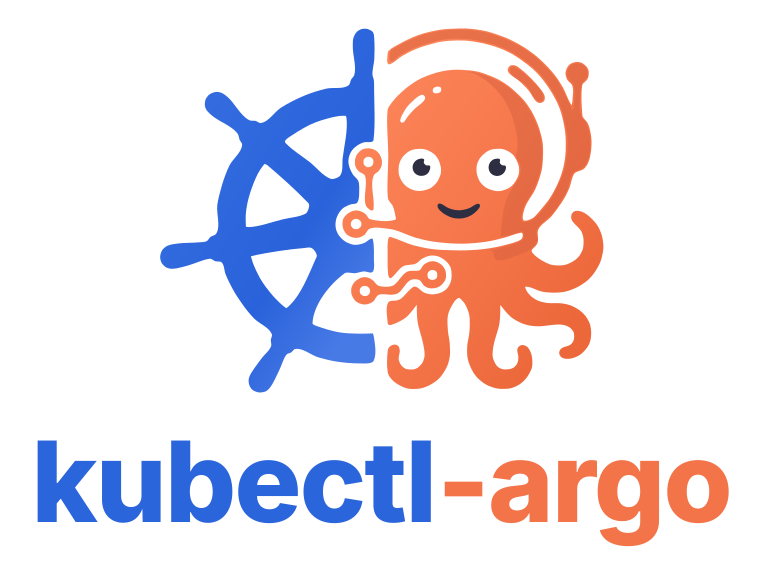
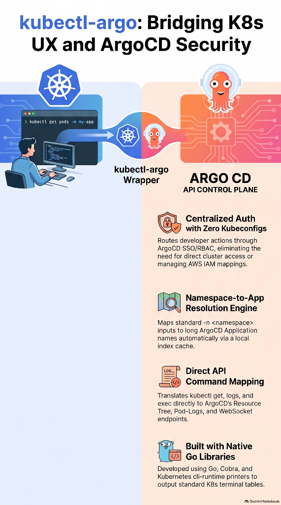

# kubectl-argo



**Bridging `kubectl` UX and Argo CD Security — Zero Kubeconfigs Required**

[](go.mod)
[](https://argo-cd.readthedocs.io/)
[](https://kubernetes.io/docs/tasks/extend-kubernetes/kubectl-plugins/)

---

## Overview

`kubectl-argo` is a `kubectl` plugin written in Go that translates familiar `kubectl` commands (`get`, `logs`) directly into **Argo CD API** calls. It gives developers the muscle-memory experience of `kubectl` without requiring a `kubeconfig`, direct Kubernetes API server connectivity, or cloud-provider IAM mappings—relying 100% on **Argo CD SSO and RBAC**.



### Key Capabilities

- **Centralized Auth with Zero Kubeconfigs**: Authenticates using your existing `~/.argocd/config` session (created via `argocd login --sso`) or `ARGOCD_SERVER` / `ARGOCD_AUTH_TOKEN` environment variables.
- **Silent Namespace-to-Application Resolution Engine**: Automatically maps developer-known Kubernetes namespaces (`-n <namespace>`) to complex, Helm-generated Argo CD Application names (e.g., `clustername-teamname-workload-prod`) via `ApplicationService.List` and caches mappings locally for fast subsequent lookups.
- **Direct API Command Mapping**: Translates `kubectl argo get` and `kubectl argo logs` directly to Argo CD's Resource Tree and PodLogs gRPC/REST endpoints.
- **Native `kubectl` Table Formatting**: Uses `k8s.io/cli-runtime/pkg/printers` to render standard Kubernetes terminal tables (`NAME`, `READY`, `STATUS`, `RESTARTS`, `AGE`, `-o wide`).

---

## Quick Start

### 1. Authenticate with Argo CD

Log in to your Argo CD server using SSO (no `kubeconfig` required):

```bash
argocd login argocd.example.com --sso
```

### 2. Inspect Resources in Your Namespace

Pass your standard Kubernetes namespace with `-n`. `kubectl-argo` silently resolves it to the underlying Argo CD Application name:

```bash
# List pods in the payments-prod namespace
kubectl argo get pods -n payments-prod

# List services and ingresses
kubectl argo get svc -n payments-prod
kubectl argo get ing -n payments-prod -o wide
```

### 3. View or Stream Pod Logs

```bash
# Tail the last 100 lines and follow live output
kubectl argo logs -f --tail=100 web-6d4f8b7c9-x2k9p -n payments-prod
```

---

## Installation

### Prerequisites

- **Argo CD CLI** (`argocd`) v2.x+ (for `argocd login --sso`, or an Argo CD API token)
- **Go 1.22+** (when building from source)
- **`kubectl`** (optional, to invoke the binary as `kubectl argo ...` instead of `kubectl-argo ...`)

### Install from GitHub Releases

Download the pre-compiled binary for your OS and architecture (`linux/amd64`, `linux/arm64`, `darwin/amd64`, `darwin/arm64`, or `windows/amd64`) from the [Releases page](https://github.com/ronel99/kubectl-argo/releases):

```bash
OS="$(uname -s | tr '[:upper:]' '[:lower:]')"
ARCH="$(uname -m | sed 's/x86_64/amd64/;s/aarch64/arm64/')"
VERSION="v0.1.0"

curl -sL "https://github.com/ronel99/kubectl-argo/releases/download/${VERSION}/kubectl-argo_${VERSION}_${OS}_${ARCH}.tar.gz" | tar -xz kubectl-argo
sudo mv kubectl-argo /usr/local/bin/kubectl-argo
```

### Build and Install from Source

```bash
git clone https://github.com/ronel99/kubectl-argo.git
cd kubectl-argo

# Download module dependencies and compile
go mod tidy
go build -o kubectl-argo .

# Move the binary into your PATH so kubectl discovers it as a plugin
sudo mv kubectl-argo /usr/local/bin/kubectl-argo
```

Verify the plugin is recognized by `kubectl`:

```bash
kubectl plugin list
kubectl argo --help
```

---

## Using `kubectl-argo`

### Authentication & Configuration Precedence

`kubectl-argo` never reads `~/.kube/config`. Connection parameters are resolved via Viper in the following order (highest to lowest priority):

1. **CLI Flags**: `--server`, `--auth-token`, `--insecure`, `--grpc-web`, `--plaintext`, `--argocd-config`
2. **Environment Variables**:
   ```bash
   export ARGOCD_SERVER="argocd.example.com:443"
   export ARGOCD_AUTH_TOKEN="eyJhbGciOi..."
   export ARGOCD_INSECURE="false"
   export ARGOCD_GRPC_WEB="true"
   ```
3. **Argo CD Config File (`~/.argocd/config`)**: Automatically parses the active `current-context`, server settings, and user token written by `argocd login --sso`.

### How the Resolution Engine Works

In many multi-tenant Argo CD setups, a Helm chart or ApplicationSet generates long application names such as `us-east1-prod-payments-team-checkout-service`. Developers only know their Kubernetes namespace (`checkout-prod`).

When you run `kubectl argo <cmd> -n checkout-prod`:
1. `kubectl-argo` checks its local namespace index cache at `~/.cache/kubectl-argo/namespace_cache.json` (default TTL: **5 minutes**).
2. On a cache miss or expiration (or when `--refresh-cache` is passed), it calls Argo CD's `ApplicationService.List` API.
3. It indexes `spec.destination.namespace` $\rightarrow$ `metadata.name` and resolves `checkout-prod` to `us-east1-prod-payments-team-checkout-service`.
4. All subsequent API calls (`ResourceTree`, `PodLogs`) transparently execute against the resolved Argo CD Application.

### Command Reference

#### `kubectl argo get`

Fetches the live resource tree (`GET /api/v1/applications/{resolved-app-name}/resource-tree`), filters by the requested Kubernetes `Kind`, and renders a native `kubectl` table.

```bash
kubectl argo get (pods|svc|ing) [NAME] -n <namespace> [flags]
```

**Supported Resource Types & Aliases:**
| Resource Kind | Supported CLI Aliases | Columns Displayed |
| :--- | :--- | :--- |
| `Pod` | `po`, `pod`, `pods` | `NAME`, `READY`, `STATUS`, `RESTARTS`, `AGE` (+ `NODE`, `HEALTH` with `-o wide`) |
| `Service` | `svc`, `service`, `services` | `NAME`, `TYPE`, `CLUSTER-IP`, `EXTERNAL-IP`, `PORT(S)`, `AGE` (+ `HEALTH` with `-o wide`) |
| `Ingress` | `ing`, `ingress`, `ingresses` | `NAME`, `HOSTS`, `ADDRESS`, `AGE` (+ `HEALTH` with `-o wide`) |

**Examples:**
```bash
# List all pods in namespace my-app
kubectl argo get pods -n my-app

# Get a specific pod with wide columns (Node and Argo CD Health status)
kubectl argo get pod api-server-7b9d8c-2xklp -n my-app -o wide

# Print services without headers (useful for scripting)
kubectl argo get svc -n my-app --no-headers

# Force refresh the namespace-to-application cache before querying
kubectl argo get ing -n my-app --refresh-cache
```

#### `kubectl argo logs`

Streams container logs for a specific pod via the Argo CD `PodLogs` API (gRPC stream with automatic REST fallback).

```bash
kubectl argo logs (POD | pod/POD) -n <namespace> [flags]
```

**Supported Flags:**
| Flag | Shorthand | Default | Description |
| :--- | :---: | :---: | :--- |
| `--follow` | `-f` | `false` | Stream live log output until interrupted (`Ctrl+C`) |
| `--tail` | | `-1` | Number of recent lines to display (`-1` shows all available lines) |
| `--container` | `-c` | `""` | Target container name (for multi-container pods) |
| `--previous` | `-p` | `false` | Print logs for the previous terminated instance of the container |
| `--timestamps` | | `false` | Prefix each log line with its RFC3339 timestamp |

**Examples:**
```bash
# Fetch all logs from a pod
kubectl argo logs api-server-7b9d8c-2xklp -n my-app

# Follow logs from a specific sidecar container showing the last 50 lines
kubectl argo logs -f --tail=50 -c istio-proxy pod/api-server-7b9d8c-2xklp -n my-app

# Inspect crash logs from the previous container instance with timestamps
kubectl argo logs -p --timestamps api-server-7b9d8c-2xklp -n my-app
```

#### Global Persistent Flags

| Flag | Shorthand | Default | Description |
| :--- | :---: | :---: | :--- |
| `--namespace` | `-n` | `"default"` | Target Kubernetes namespace (resolved to Argo CD Application) |
| `--argocd-config` | | `"~/.argocd/config"` | Path to Argo CD CLI configuration file |
| `--server` | | `""` | Override Argo CD server address (`host:port`) |
| `--auth-token` | | `""` | Override Argo CD bearer authentication token |
| `--insecure` | | `false` | Skip TLS certificate verification |
| `--grpc-web` | | `true` | Enable gRPC-Web transport for Argo CD API calls |
| `--plaintext` | | `false` | Connect over plain HTTP without TLS |
| `--refresh-cache` | | `false` | Bypass local disk cache and re-query `ApplicationService.List` |

---

## Project Layout

```text
kubectl-argo/
├── main.go                         # CLI entrypoint
├── go.mod                          # Go module definition & dependencies
├── cmd/
│   ├── root.go                     # Root Cobra command, persistent flags & PreRun resolution hook
│   ├── get.go                      # `get (pods|svc|ing)` implementation & cli-runtime TablePrinter
│   └── logs.go                     # `logs` implementation (`-f`, `--tail`, `-c`, `-p`, `--timestamps`)
├── internal/
│   ├── config/
│   │   └── config.go               # Viper loader for ~/.argocd/config, env vars & CLI flags
│   └── argocd/
│       ├── client.go               # Argo CD apiclient wrapper
│       ├── resolver.go             # Namespace-to-Application Resolution Engine & local disk cache
│       ├── resources.go            # ResourceTree REST/gRPC client & Kind filtering
│       └── logs.go                 # PodLogs gRPC/REST streaming client
└── docs/
    └── assets/
        ├── logo.svg                # Project logo (scalable vector SVG)
        └── infographic.png         # Architecture & workflow overview infographic
```

---

## Contributing

Contributions are welcome! Whether you are adding support for new resource kinds, implementing `kubectl argo exec` via Argo CD's terminal WebSocket API, or improving caching behavior, follow the steps below to get started.

### Development Workflow

1. **Fork and clone the repository:**
   ```bash
   git clone <your-fork-url>
   cd kubectl-argo
   ```
2. **Create a feature branch:**
   ```bash
   git checkout -b feat/my-feature
   ```
3. **Build and test your changes:**
   ```bash
   go vet ./...
   go test -v ./...
   go build -o kubectl-argo .
   ```

### Adding a New Subcommand

1. Create a new file under `cmd/` (e.g., `cmd/exec.go`) and register your `*cobra.Command` with `rootCmd.AddCommand(...)` in `init()`.
2. Retrieve the authenticated Argo CD client and resolved application inside `RunE` using the context helpers from `cmd/root.go`:
   ```go
   client, err := ClientFromContext(cmd.Context())
   if err != nil {
       return err
   }
   resolvedApp, err := ResolvedAppFromContext(cmd.Context())
   if err != nil {
       return err
   }
   ```
3. Place any Argo CD gRPC or REST interaction inside `internal/argocd/` to keep command handlers focused on CLI ergonomics and output formatting.
4. Open a Pull Request with a clear summary of your changes and example CLI output.
